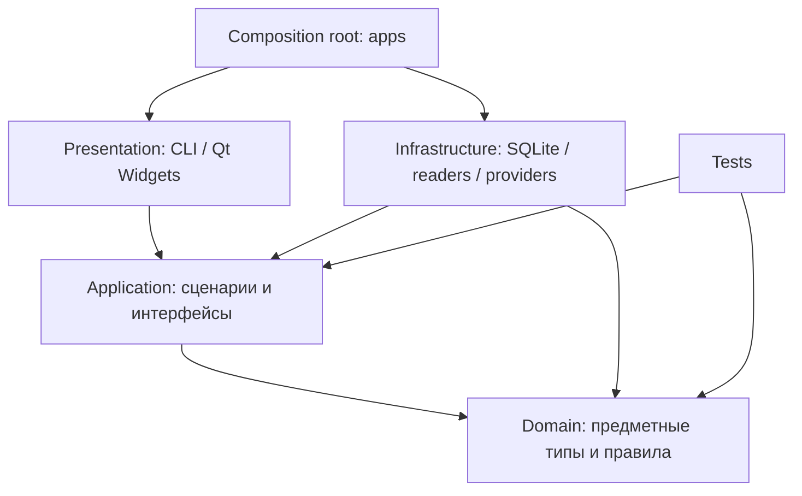

# Архитектура — результат проектирования этапа 2

Редакция от **26.10.2026**, подготовлена по поручению студента самостоятельно спроектировать архитектуру. Это проект устройства приложения, а не описание работающего кода. Студент 26.10.2026 разрешил коммит и push; эта редакция фиксирует этап 2 тегом `v0.2`. Основания и альтернативы — в [DECISIONS.md](DECISIONS.md); продукт — в [PRODUCT.md](PRODUCT.md).

Студент выбрал C++20 + CMake + Qt 6 17.09.2026, а 26.10.2026 уточнил: **Windows 10 и 11**, первый внешний сервис — **OpenAI**, история сохраняется, **каждый вопрос самостоятельный**. Остальные технические решения ниже выбраны в рамках порученного проектирования; отдельного утверждения преподавателем не заявляется. Зависимости и модели не установлены.

## 1. Границы и выбранная конфигурация

Пользователь — руководитель проектов, который ищет и сопоставляет сведения из ТЗ, договора и протоколов. Приложение извлекает подтверждения; решение о том, принят ли документ и как трактовать противоречие, остаётся за человеком. Полный аудит всех требований и автоматическое юридическое заключение в MVP не входят.

| Область | Решение |
|---|---|
| Платформа | Windows 10/11 x64; исходная конфигурация сборки — MSVC 2022, CMake, C++20 |
| Интерфейс | CLI для этапа 3; Qt 6 Widgets для MVP, только Presentation |
| Хранение | SQLite: текст, чанки, векторы, полнотекстовый индекс, кэш и история; копии исходных файлов рядом с БД |
| Поиск | Локальные эмбеддинги + SQLite FTS5; точный перебор векторов без отдельной векторной БД |
| Внешняя генерация | OpenAI Responses API; начальный профиль `gpt-5.4-mini-2026-03-17`, заменяемый через настройки |
| Локальная генерация | Встроенная библиотека llama.cpp, Qwen3-4B GGUF Q4_K_M, CPU, без thinking |
| Эмбеддинги | Qwen3-Embedding-0.6B GGUF Q8_0 через llama.cpp; 1024 компоненты, pooling last, нормирование вектора |
| Ключ | Windows Credential Manager; переменная окружения только для разработки |
| Поставка | THIN — внешняя генерация; FAT — внешняя и локальная. В обеих сборках локальный поиск |

Здесь «встроенная llama» означает выбранный в проекте движок **llama.cpp**, а модель генерации — Qwen. Это уточнение проектного решения, не свидетельство отдельного согласования семейства весов преподавателем. Движок и веса — разные компоненты.

Проверенный 26.10.2026 компьютер: AMD Ryzen 5 7640HS, 6 ядер / 12 потоков; система сообщает около 15,2 ГиБ физической памяти; AMD Radeon 760M, Windows 11 x64. Отдельная видеокарта не обнаружена. Показатель AdapterRAM встроенного адаптера не используется как оценка всей доступной GPU-памяти. Базовый путь — CPU, без обязательных CUDA/Vulkan.

Начальная гипотеза для FAT — ПК с 16 ГБ RAM; реальные требования и время ответа измеряются на этапе 4. Модели поиска и генерации можно загружать последовательно, освобождая память; загрузка входит во время ответа. Цель «до 5 минут» не подтверждена.

## 2. Модули и зависимости



Стрелки означают зависимость кода, а не порядок выполнения. Application вызывает интерфейсы, реализации которых переданы при запуске; он не подключает заголовки Infrastructure. Domain не знает о сети, Qt, SQLite и llama.cpp. Qt-типы не пересекают границу Presentation: данные передаются обычными C++-типами. Сборку объектов выполняет `apps`, а не окно или глобальный Service Locator.

План целей CMake: `rag_domain`, `rag_application`, `rag_infrastructure`, `rag_cli`, позднее `rag_gui`, `rag_tests`. Тесты предметной логики не требуют Qt или настоящей модели. Интеграционные тесты отдельно подключают проверяемые адаптеры.

План структуры при появлении кода (сейчас каталоги не создаются):

```text
include/rag/domain/          src/domain/
include/rag/application/     src/application/
src/infrastructure/         src/presentation/cli/
src/presentation/qt/        apps/
tests/unit/                tests/integration/
data/demo/
```

## 3. Классы, инкапсуляция и контракты

| Класс Domain | Состояние и операции | Чего не делает |
|---|---|---|
| `Library` | ID, политика, текущая ревизия; допустимые переходы состояния | Не читает файлы и не вызывает модели |
| `Document` | ID, версия содержимого, формат, статус, политика; отмечает готовность/ошибку | Не парсит PDF и не управляет окном |
| `Chunk` | ID, текст, документ и его версия, позиция; непустой текст и корректные границы | Не хранит SQL и API-ключ |
| `Question` | Исходный текст и форма для сравнения; отклоняет пустой вопрос | Не включает историю скрытым образом |
| `Citation` | Ссылка на чанк, точная цитата, позиция в сохранённом источнике | Не доверяет пути/странице из ответа модели |
| `Answer` | Answered / InsufficientEvidence, утверждения с цитатами, ревизия и модель | Не доказывает истинность трактовки документа |

`SourceLocation`, `ModelProfile`, `IndexRevision`, `AppError` — небольшие типы значений, без отдельных иерархий. Состояние предметных объектов приватно, инварианты проверяются при создании и изменении. Объекты составляются по значению; зависимости передаются через конструктор. `unique_ptr` владеет реализацией интерфейса; разделяемое владение не вводится без необходимости.

| Компонент Application | Ответственность |
|---|---|
| `IndexingService` | Импорт, разбиение, локальные эмбеддинги, публикация ревизии, обновление/удаление документов |
| `RagService` | Вопрос, единственная проверка политики перед выбором провайдера, поиск, запрос, история |
| `HybridRetriever` | Слияние поиска слов и поиска по векторам; отбор контекста в пределах бюджета |
| `CachingLlmProvider` | Декоратор: вернуть готовый ответ или вызвать вложенный провайдер и сохранить успешный результат |
| `ValidatingLlmProvider` | Декоратор: проверить структуру и цитаты относительно переданного контекста; не проверяет смысловую истинность |
| `AnswerCache` | Построение ключа и доступ к кэшу через порт; без SQL и сети |

Нарезка текста и нормализация вопроса сначала являются обычными функциями, а не классами ради количества. Декораторы разделены по обязанностям: кэш контролирует повторные расходы, валидатор не допускает сохранения структурно неверного ответа.

| Порт в Application | Контракт | Реализации |
|---|---|---|
| `IDocumentReader` | Снимок файла → текстовые блоки с позициями или ошибка; без сети | `TxtReader`, `PdfReader`, `DocxReader` |
| `IKnowledgeStore` | Снимок ревизии, чанки/векторы/совпадения слов; атомарная публикация импорта/удаления | `SqliteKnowledgeStore`, `InMemoryKnowledgeStore` |
| `IEmbeddingProvider` | Текст → вектор фиксированной размерности и профиль; только локально | `LocalEmbeddingProvider`, тестовая реализация |
| `IRetriever` | Вопрос + ревизия → упорядоченные подтверждения с бюджетом | `HybridRetriever`, простой `KeywordRetriever` для этапа 3 |
| `ILlmProvider` | Неизменяемый запрос с вопросом, контекстом, ревизией, профилем → результат/ошибка; отмена | `RemoteApiProvider`, `LocalLlamaProvider`, декораторы, `MockProvider` |
| `IAnswerCacheStore` | Прочитать/записать проверенный ответ по ключу, удалить недействительные записи | SQLite и реализация в памяти |
| `IHistoryStore` | Записать завершённый обмен, прочитать/очистить историю | SQLite и реализация в памяти |

Один SQLite-адаптер может реализовать несколько портов, используя одну БД. Порты описывают сценарии, а не универсальный ORM. При замене БД меняются адаптеры и сборка объектов, не Domain и сценарии. Внутренние `ISecretStore` и `IHttpTransport` в Infrastructure нужны для подмены системного хранилища и сети; бизнес-логика не получает ключ.

Ожидаемые ошибки возвращаются через `Result<T, AppError>` на базе `std::variant` (C++20). `std::expected` не выдаётся за стандартный C++20-тип. Исключения библиотек перехватываются на границе адаптера. Коды ошибок стабильны; локализация принадлежит Presentation.

## 4. Импорт и ссылки на источники

1. Пользователь выбирает файлы/папку и политику. По умолчанию новый документ `LocalOnly`; `AllowRemote` — явное действие для перечисленных документов. Политика библиотеки может дополнительно запретить сеть всем документам.
2. Файл копируется в библиотеку под служебным ID, вычисляется SHA-256. Читается именно копия: исходник может измениться. Дубликат одинакового содержимого внутри библиотеки повторно не индексируется; другой путь не расширяет разрешения.
3. Reader извлекает блоки и позиции. Чанкер уважает абзацы/страницы: исходные параметры — до 400 токенов модели эмбеддингов, перекрытие до 60 внутри блока; длинный блок делится. Параметры версионируются и проверяются испытаниями.
4. Локально получаются векторы, готовятся текст и FTS5. Только завершённый документ публикуется транзакцией с новой ревизией; состояние обработки не доступно поиску. У файлов пакета отдельные статусы, ошибка одного не отменяет остальные.
5. Обновление импортирует новую копию. До успеха видна прежняя версия с отметкой о незавершённом обновлении; после успеха прежний кэш не актуален. Разрешение отправки новой версии подтверждается отдельно: новое содержимое по умолчанию LocalOnly. Удаление исключает документ из поиска и удаляет связанные кэш, историю и снимки; связи учитывают все документы переданного контекста, а не только процитированные.

| Формат | Извлечение | Ориентир цитаты |
|---|---|---|
| TXT | Стандартный C++: UTF-8 с/без BOM, UTF-16 с BOM; иная кодировка — ошибка с предложением сохранить в UTF-8 | Строки и диапазон символов сохранённого текста |
| PDF | PDFium, текстовый слой постранично; без JavaScript/XFA и OCR | Страница и позиции текста; сложная вёрстка может нарушать порядок чтения |
| DOCX | miniz для ZIP + pugixml для XML: основной текст, таблицы, колонтитулы, сноски как именованные части | Часть, абзац или таблица/строка/ячейка; страницы не придумываются |

DOCX читается без исполнения макросов и переходов по внешним relationships; удалённые правками фрагменты не смешиваются с видимым текстом. Неподдержанные части, например вложенные объекты или сложные текстовые блоки, отмечаются как неполное извлечение. В PDF отмечаются страницы без текста. Ограничения распаковки, длины XML и памяти дают явную ошибку, а не молчаливую обрезку.

Цитата открывает встроенную панель сохранённого текста с выделением и ориентиром; отдельная команда открывает копию оригинала. Точное позиционирование курсора в установленном Word не требуется. Ссылки строит приложение по ID, не LLM. Снимок и хэш отличают старую цитату от текущего исходника.

## 5. Вопрос, поиск и ответ

```mermaid
sequenceDiagram
    participant UI as CLI / GUI
    participant R as RagService
    participant S as Store / Retriever
    participant C as CachingLlmProvider
    participant V as ValidatingLlmProvider
    participant P as Remote / Local / Mock
    UI->>R: самостоятельный вопрос + библиотека + профиль
    R->>S: получить готовую ревизию
    R->>R: проверить политику доступа
    R->>S: найти подтверждения локально
    R->>C: неизменяемый запрос
    alt есть кэш
        C-->>R: сохранённый ответ
    else нет кэша
        C->>V: запрос
        V->>P: сгенерировать
        P-->>V: результат модели
        V->>V: проверить ссылки и цитаты
        V-->>C: проверенный результат или ошибка
        C-->>R: ответ; успех сохраняется в кэш
    end
    R-->>UI: ответ / недостаточно подтверждений / ошибка
```

История сохраняется для просмотра, но не отправляется модели и не добавляется к запросу. Интерфейс поясняет: «Каждый вопрос задаётся отдельно; укажите документ или пункт явно».

Гибридный поиск объединяет top-20 FTS5/BM25 и top-20 cosine similarity через Reciprocal Rank Fusion: сумма `1 / (60 + место)` для каждого списка, стабильная сортировка с ID чанка для равенств. Это исходные параметры, не доказанный оптимум. FTS5 `unicode61` не считается русским морфологическим анализатором; смысловой поиск выполняется многоязычной моделью. Пользовательский текст экранируется, не исполняется как синтаксис FTS/SQL.

В контекст попадает до 8 неповторяющихся фрагментов; пока есть альтернативы, не более 2 от одного документа, затем остаток заполняется по рейтингу. Бюджет включает инструкции, вопрос, контекст и ответ. Первый локальный профиль: 8192 токена контекста, резерв ответа до 1024. Внешний профиль использует собственный подсчёт или консервативную верхнюю оценку, а не токенизатор другой модели.

30 файлов не отправляются целиком. Top-k не гарантирует полноты проверки всех требований: ответ описывает найденные подтверждения. Для сложного сравнения пользователь уточняет вопрос. Пустая библиотека/отсутствие кандидатов дают результат без LLM; наличие кандидатов не доказывает достаточность информации.

Модель получает правила, вопрос и фрагменты с непрозрачными ID. Документы — данные, инструкции внутри них не исполняются. У модели нет инструментов, доступа к файлам, URL или системным вызовам. Результат содержит статус, утверждения, для каждого — `chunk_id` и точную цитату. При InsufficientEvidence показывается стандартное сообщение, а не свободный неподтверждённый ответ.

Валидатор отклоняет неизвестный ID, цитату вне переданного фрагмента, утверждение без цитаты, неверную структуру и незавершённый ответ. Координаты восстанавливаются по сохранённому тексту; неоднозначная цитата получает диапазон фрагмента. Проверка **не доказывает**, что утверждение логически следует из цитаты. Смысл и различение «предложено / принято» проверяются вручную на размеченных документах. Автоматических платных повторов для исправления ответа нет.

## 6. Кэш и приватность

Цепочка: `CachingLlmProvider(ValidatingLlmProvider(realProvider))`. Декораторы реализуют `ILlmProvider`, RagService получает композицию. Ошибки, таймауты, неверные цитаты не кэшируются. Корректный InsufficientEvidence можно сохранить с ревизией и профилем.

Логический ключ сохраняется: `SHA-256(нормализованный вопрос + версия индекса + id модели)`. Поля сериализуются однозначно с длинами, без простой склейки:

- Вопрос: удаляются внешние пробелы, унифицируются переводы строк; регистр, числа, знаки и внутренние пробелы сохраняются.
- Версия индекса: ID библиотеки + счётчик ревизии. Новая ревизия при изменении документов, политики, модели эмбеддингов, чанкинга, поиска или шаблона инструкций.
- ID модели: сервис/endpoint + конкретная модель или хэш GGUF + параметры генерации + версия формата ответа. Смена ключа API меняет пространство кэша профиля без включения секрета в ключ.
- При смене модели старый кэш профиля инвалидируется; перезапуск без изменений сохраняет кэш. Отметка «из кэша» и счётчик отражают пропущенные вызовы, а не неподтверждённую экономию в рублях.

Политика проверяется **до чтения кэша**, в одной точке `RagService`. Для внешнего профиля библиотека и все документы набора должны разрешать отправку. При наличии `LocalOnly` вопрос блокируется; закрытые документы не исключаются молча. В MVP набор — вся текущая библиотека; иной набор оформляется отдельной библиотекой. В THIN предлагается FAT для локальных вопросов, а не обход запрета.

В локальном режиме нет исходящих запросов: проверки ключа/обновлений, каталога моделей, телеметрии, localhost-сервера. Поиск и эмбеддинги всегда локальны, в том числе в THIN. Базовая поставка содержит веса; другую модель можно импортировать из файла. Если позже появится загрузка из сети, только по отдельному действию пользователя, без документов.

В MVP одновременно открыта одна библиотека; одна очередь работ, один активный вопрос и один процесс-владелец БД. Повторная отправка во время работы не создаёт второй вызов. Изменение документов, библиотеки, политики или режима требует отмены/завершения текущей операции; UI показывает переходное состояние. Локальный режим включён только после окончания сетевой работы; уже отправленные данные отозвать нельзя. Следующая операция получает новый неизменяемый снимок.

Кэш и история — локальные пользовательские данные, очищаемые пользователем. Логи содержат служебные ID, коды ошибок, длительности и счётчики, без вопросов, ответов, содержимого, ключей, полных путей и тел HTTP. Шифрование библиотеки в MVP не предусмотрено.

## 7. Хранение и восстановление

Каталог данных — `%LOCALAPPDATA%/RagBot/`, отдельно от установки и Git. Одна SQLite-БД на библиотеку, копии исходников в управляемом каталоге `sources/`. Секретов в БД нет.

| Данные | Назначение и связи |
|---|---|
| `library`, `schema_version` | Политика, активная ревизия, версия схемы/конфигурации |
| `documents` | ID, хэш/версия, имя, относительный путь копии, формат, политика, статус |
| `chunks`, `chunks_fts` | Текст, позиции, документ; синхронный FTS5-индекс готовых чанков |
| `embeddings` | Чанк, профиль, размерность, нормированный float32-вектор (BLOB с заданным форматом) |
| `answer_cache` | Ключ, ревизия, профиль, проверенный ответ и связи с документами |
| `history` | Самостоятельные вопросы/результаты, цитаты, дата, профиль, ревизия, признак кэша |

Текст, векторы, FTS5 и ревизия публикуются одной транзакцией. Снимок сначала записывается во временный файл и переименовывается, затем коммитится ссылка из БД. Сбой оставляет максимум неиспользуемую копию для очистки, а не готовую ревизию со ссылкой на недописанный файл. При удалении сначала коммитится исключение из БД, затем убирается файл; ошибка очистки сообщается. Безвозвратное стирание с накопителя не обещается.

Включены внешние ключи и версии схемы. Перед миграцией — копия штатным SQLite backup API, не случайное копирование открытой БД. Неудачная миграция не стирает библиотеку. При ошибке операции сохраняется предыдущая согласованная ревизия, если сама БД не повреждена. Повреждение БД не исправляется молчаливой пересборкой поверх пользовательских данных.

Отдельного HNSW/FAISS-файла нет. Векторы читаются блоками; точное сравнение стоит `O(N × d)`. Расчёт: 10 000 × 1024 × 4 байта ≈ 39 МиБ только числовых данных. Это не замер и не предел документов. Если измерения выявят узкое место, адаптер поиска заменяется при сохранении канонических данных в SQLite.

## 8. Адаптеры и поставка

`RemoteApiProvider` использует WinHTTP через `IHttpTransport` и nlohmann/json. Первый endpoint фиксирован на OpenAI; HTTPS с проверкой сертификата, запрет перенаправления с Authorization на другой адрес. Остальные «OpenAI-совместимые» сервисы не объявляются поддержанными без отдельной интеграции.

Запрос: Responses API, `store: false`, без server-side conversation, tools и загрузки файлов; JSON Schema через `text.format`. Отказы и incomplete обрабатываются отдельно. `store: false` не означает полного отсутствия хранения у провайдера; LocalOnly всё равно запрещён. Основание: [Structured Outputs](https://developers.openai.com/api/docs/guides/structured-outputs), [Data controls](https://developers.openai.com/api/docs/guides/your-data). Начальный профиль и функции API проверены по [карточке GPT-5.4 mini](https://developers.openai.com/api/docs/models/gpt-5.4-mini); доступ в аккаунте не проверен.

Ключ вводится в GUI, сохраняется системным адаптером. Проверка ключа не вызывает отдельный API-запрос при запуске или сохранении: отсутствие доступа обнаруживается при явно запрошенной удалённой генерации, проходящей через кэш. Credential Manager не обещает защиту от любых процессов того же пользователя.

`LocalLlamaProvider` вызывает библиотеку напрямую, без Ollama, Python и сервера. FAT включает провайдер и веса генерации, THIN — нет. **Обе сборки содержат общий runtime llama.cpp и модель эмбеддингов**: THIN означает отсутствие локальной генерации, а не всех ML-компонентов. `WITH_LOCAL_LLM=OFF` отключает реализацию генератора; бизнес-логика не содержит этой условной компиляции.

GUI: библиотека/статусы, история/вопрос/ответ, панель цитат/источника; настройки профиля, модели и ключа. При разрешении отправки показаны сервис и документы. UI не подменяет проверку Application. Долгая работа выполняется вне GUI-потока, с прогрессом и отменой; обновления окна передаются средствами Qt, UI-объекты не используются из рабочего потока.

Базовая поставка — архив с каталогом EXE, DLL/плагинов Qt, runtime, весов и лицензий: распаковать и запустить EXE без терминала. Упаковка проверяется через `windeployqt`; пользователь не устанавливает среду разработки. При необходимости добавляется установщик. Один автономный EXE не обещается. Нужны испытания на чистых Windows 10 и 11, без Qt/компилятора, с Unicode-путями и проверкой всех runtime DLL.

## 9. Зависимости и интеграция

Это **выбор для проекта**, не выполненная установка и не разрешение автоматически скачивать зависимости. При подключении фиксируются версии/commit SHA, суммы весов, источники, лицензии транзитивных компонентов. Сборка не получает «последнюю» версию молча. Инструменты подготовки пакета не устанавливаются пользователю.

| Компонент | Назначение | Основание и проверка при подключении |
|---|---|---|
| Qt 6 Widgets, исходная линия 6.10.x | GUI | [Windows 10/11 x64, MSVC 2022](https://doc.qt.io/qt-6.10/supported-platforms.html); конкретный patch проверить. [Лицензирование](https://doc.qt.io/qt-6.10/licensing.html): путь LGPLv3 с динамическими библиотеками, проверить комплект |
| SQLite + FTS5 | Хранение, поиск слов | [FTS5](https://sqlite.org/fts5.html), [public domain](https://sqlite.org/copyright.html); включить FTS5 |
| llama.cpp | Локальный вывод | [Исходники и MIT license](https://github.com/ggml-org/llama.cpp); закрепить ревизию с поддержкой обеих моделей |
| Qwen3-4B GGUF Q4_K_M | Генерация | [Карточка автора, Apache-2.0](https://huggingface.co/Qwen/Qwen3-4B-GGUF); шаблон диалога, отключение thinking, память, цитаты |
| Qwen3-Embedding-0.6B GGUF Q8_0 | Поиск | [Карточка автора, Apache-2.0](https://huggingface.co/Qwen/Qwen3-Embedding-0.6B-GGUF); инструкция вопроса, pooling last, нормализация, единый профиль |
| PDFium | PDF | [API текста](https://pdfium.googlesource.com/pdfium/+/refs/heads/main/public/fpdf_text.h), [лицензия и notices](https://pdfium.googlesource.com/pdfium/+/refs/heads/main/LICENSE); проверить бинарную сборку и её компоненты |
| miniz + pugixml | ZIP/XML DOCX | [miniz](https://github.com/richgel999/miniz), [pugixml](https://github.com/zeux/pugixml); LICENSE закреплённых версий, ограничения входных данных |
| nlohmann/json | Формат API | [Исходники и LICENSE](https://github.com/nlohmann/json); закрепить версию |
| WinHTTP, Credential Manager, Windows CNG | HTTPS, ключи, SHA-256 | Системные адаптеры Windows; Qt Network/SQL не проникают в ядро |

Для LGPL недостаточно положить DLL: до распространения проверяются лицензии/notices, доступность соответствующих исходников Qt/модификаций, возможность замены библиотек, условия лицензии приложения. Собственная лицензия продукта и механизм продажи здесь не придумываются. Сервер активации, платежи и постоянные сетевые проверки лицензии в MVP не включены.

## 10. Ошибки и проверки

| Сценарий | Требуемое поведение и проверка |
|---|---|
| Пустой вопрос/библиотека, дубликат | Понятный результат; нет вызова LLM и дубликатов индекса |
| Недоступный/битый файл, PDF с паролем/без текста | Статус файла; обработка остальных продолжается, GUI работает |
| Повтор вопроса, перезапуск | Ответ из кэша; счётчик провайдера не увеличен |
| Изменение документа/модели/политики/поиска | Старый ответ не выдаётся как актуальный |
| LocalOnly + внешний профиль, даже при наличии кэша | Ошибка до провайдера и кэша; сетевых вызовов 0 |
| Локальный импорт/вопрос/запуск/история | Вызовов сети 0: транспортный spy и отдельное наблюдение сети процесса |
| Чужой ID/неверная цитата/отказ/обрыв | Нет проверенного ответа и записи кэша; автоматического повтора нет |
| Нет ключа/доступа, HTTP 401/403/429/5xx, нет сети | Понятная причина, ручной повтор; без скрытой смены сервиса/режима |
| Задержка/отмена | Начальный общий deadline вопроса 300 секунд; таймаут — ошибка, не выполненная цель скорости; UI отзывчив |
| Отмена импорта, нет места | Половина документа/индекса не публикуется |
| Нет модели/неверный GGUF/нехватка памяти | Ошибка локального профиля, без перехода в API |
| Повреждение/миграция БД | Сообщение, сохранение доступных данных; без молчаливого стирания |
| Логи | Контрольный текст и секрет отсутствуют, включая ошибки библиотек |

Тесты с подменами проверяют наш код; реальные библиотеки, упаковка, сеть и скорость требуют интеграционных испытаний. Смысл ответов проверяется человеком на размеченных документах.

## 11. Граница этапа 3 и готовность архитектуры

Первый прототип: **TXT → TxtReader → IndexingService → InMemoryKnowledgeStore → KeywordRetriever → RagService → MockProvider → цитата → CLI**. Те же границы слоёв; реальные LLM, PDF/DOCX и сохранение на диск здесь не проверяются. Qt, SQLite, ключ и модели не нужны. Тестовый executable регистрируется в CTest; отдельный тестовый фреймворк необязателен.

Проверки этапа 3: цитата с номером строки TXT; пустой TXT/вопрос без вызова провайдера; неизвестная цитата отвергается. Этап 4 добавляет SQLite, гибридный поиск, настоящие провайдеры и остальную матрицу; этап 5 — GUI и поставки.

Плановые команды этапа 3, **ещё не выполнены**:

```text
cmake -S . -B build -DBUILD_GUI=OFF -DWITH_LOCAL_LLM=OFF
cmake --build build --config Debug
ctest --test-dir build -C Debug --output-on-failure
```

| Требование этапа 2 / методички | Где раскрыто |
|---|---|
| Модули/зависимости, разделы 4–6 | Раздел 2, схема и цели сборки |
| Классы, инкапсуляция, композиция, полиморфизм | Раздел 3, порты/декораторы |
| Хранение, замена реализации | Разделы 6–7 |
| Альтернативы, приложение Б | [DECISIONS.md](DECISIONS.md), ADR-001–014 |
| Ошибки, тестируемость, ранний прототип | Разделы 10–11; будущие проверки не выданы за пройденные |
| Фиксация | CHANGELOG, AI_LOG; коммит «Описана архитектура приложения», версия `v0.2` по разрешению студента |

До подключения компонентов остаётся проверка закреплённых версий и лицензий; до заявлений о скорости — испытания. Студент разрешил фиксацию архитектуры; следующий этап — TXT-прототип. Новых согласований/показов преподавателю этот документ не утверждает.
